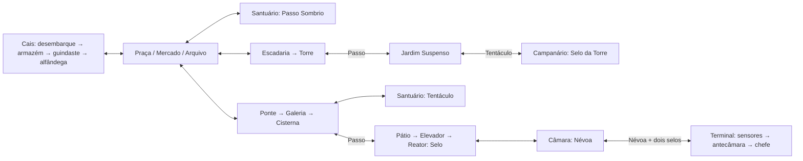

# Cidade das Sombras — estrutura de exploração

Proposta de reconstrução, ainda não implementada. Substitui a sequência linear como objetivo de design; preserva a identidade e marcos da prancha aprovada, sem prometer que seis imagens prontas bastam para um mundo explorável.

## Escala e conexões

24 salas em seis distritos. Cada sala ocupa inicialmente duas telas horizontais; torre, cisterna e poço têm também dois andares. Essas dimensões são orçamento de projeto, não obrigação de preencher espaço vazio. Praça da Fonte funciona como centro. Salas têm identidade e entradas físicas, não seleção por menu. O grafo autoritativo está em world-structure.json.

Três atalhos com alavanca do lado distante: galeria→armazém, elevador→jardim, fábrica→arquivo. Só ficam bidirecionais depois de abertos. O primeiro caminho até o elevador exige Passo; o atalho não pode contornar esse requisito.

## Progressão

1. Cais ensina salto, agarrar borda e combate em chão seguro. Chegar à praça e encontrar um bloqueio visível na rota alta.
2. Arquivo leva ao Passo Sombrio. Usar a habilidade em desafio seguro antes de uma travessia perigosa. Retornar à praça por caminho curto.
3. Explorar canal e obter Tentáculo, que alcança âncoras marcadas. Voltar ao telhado e alcançar o Selo da Torre.
4. Entrar na fábrica com Passo; abrir atalhos; desligar reator e conseguir seu selo. Encontrar Névoa.
5. Retornar à entrada do Terminal. A fresta requer Névoa e o mecanismo pede os dois selos. Completar as salas finais e enfrentar o Vigia.

Canal e telhados podem ser explorados parcialmente antes dos poderes. O jogador vê objetivos inacessíveis e os marca no mapa. Melhorias de vida e energia são opcionais; não escondem itens essenciais em paredes sem indicação.

## Construção das plataformas

Primeiro colisão cinza e travessia; depois arte modular na mesma medida. Não desenhar uma cidade plana e tentar descobrir onde o herói pisa depois.

Unidade proposta: herói com 54 unidades de altura; grade estrutural de 32. Calibrar alcance real do salto e do Passo com a física do jogo antes de fixar vãos. Saltos obrigatórios usam no máximo 80% do alcance medido; aterrissagem comum tem pelo menos duas larguras do herói. Bordas visíveis correspondem à colisão.

Cada sala registra: dimensões, portas com posição/direção/altura, pisos sólidos, plataformas atravessáveis por baixo, bordas agarráveis, escadas, âncoras, luz intensa, perigos, encontro, recompensa, ponto seguro e estado persistente. Separar decoração de superfície jogável; grades ao fundo não são escadas automaticamente.

Travessia inspirada em Prince of Persia: agarrar borda, subir, descer com controle, saltos legíveis e mecanismos antecipados. Exploração inspirada em Castlevania: rotas verticais, melhorias, habilidades e retornos. Sem exigir combate durante a primeira demonstração de uma nova habilidade.

Transições pareiam portas por identificador; preservar direção e velocidade quando apropriado, evitar nascer dentro de inimigo ou parede. Câmera acompanha dentro da sala e respeita seus limites; transição curta ao trocar de sala. Não tornar o mundo uma única imagem gigante.

Salvar após pontos seguros, poderes e atalhos: sala, ponto seguro, habilidades, itens, alavancas e chefe. Derrota não apaga poder. Salvamento local precisa de versão e fallback se armazenamento estiver indisponível.

## Produção por etapas

Primeira entrega jogável: oito salas D1–D4 e S1–S4, um poder, um bloqueio que ele abre e retorno ao centro. Validar agarrar borda, transição, mapa e salvamento antes das outras dezesseis salas. Depois canal/telhados; fábrica; Terminal.

Assets necessários: pisos, paredes e cantos em grade; plataformas de madeira/metal/pedra; portas e travas; escadas; bordas; âncoras; alavancas; elevador; frestas; pontos seguros. Fundos em camadas por distrito. Preservar os marcos visuais aprovados. Heroi precisa de agarrar/subir/soltar borda e efeitos dos poderes separados do corpo. A prancha conceitual recente ainda exige recorte e correção de ciclos.

Critérios para aceitar cada etapa: caminho de ida e volta sem reposicionamento de teste; bloqueio impossível sem habilidade e possível com ela; atalhos persistentes; recarga restaura progresso; morte recupera ponto seguro; entradas não prendem o herói; screenshots verificam arte, escala e piso. Validação do grafo só prova acesso lógico, não física, diversão ou dificuldade.
